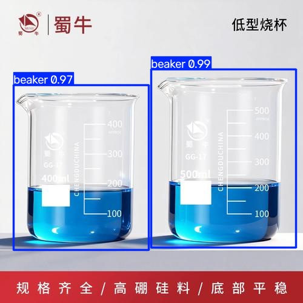
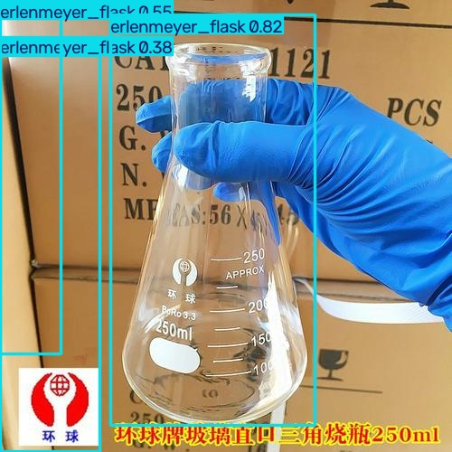
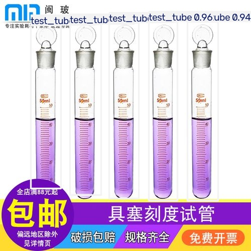
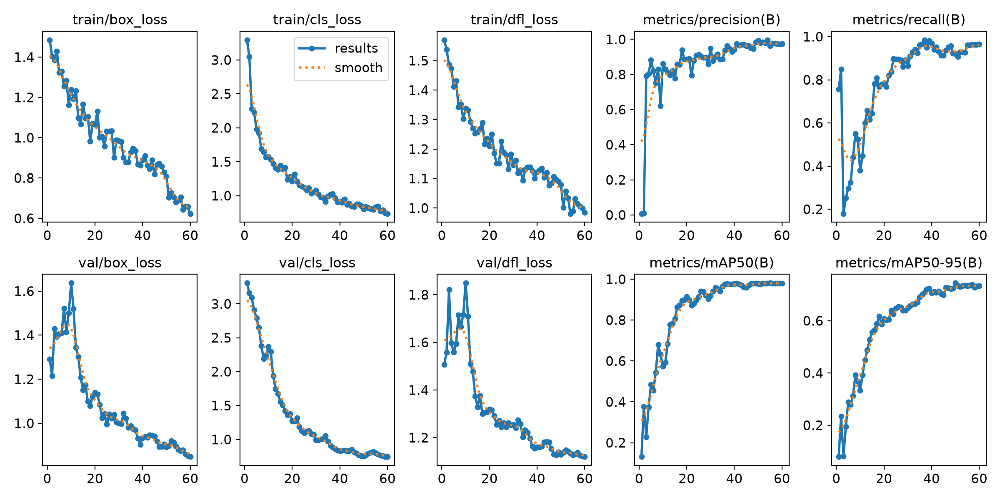
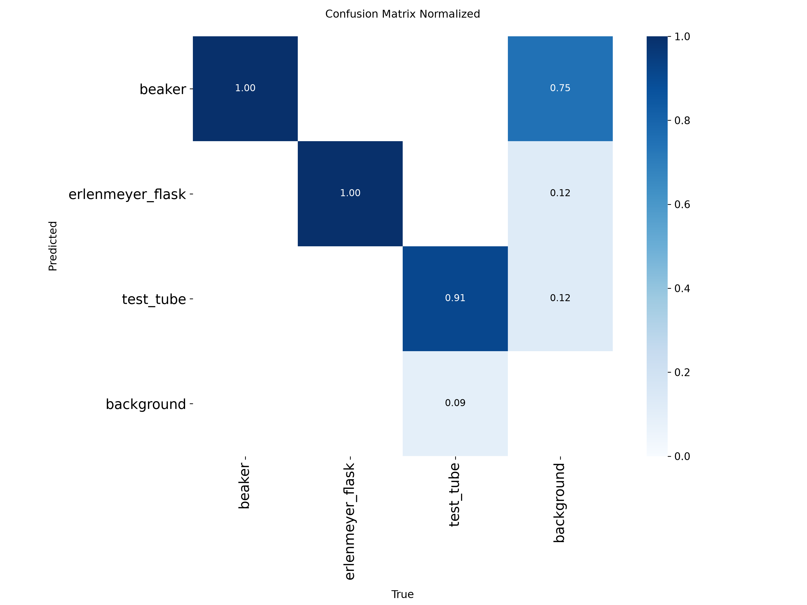
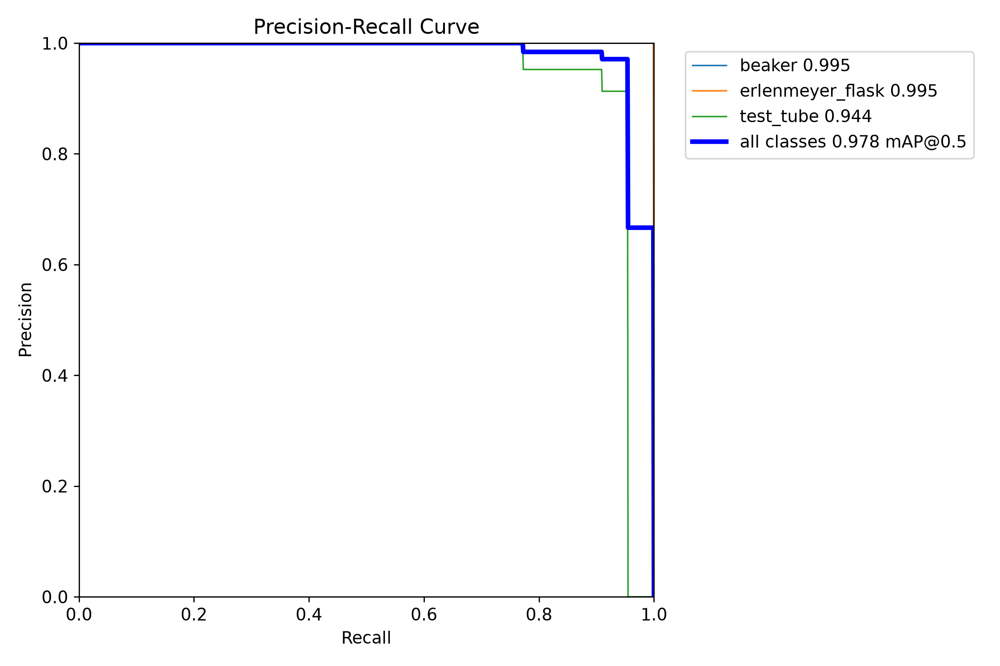

# YOLOv8 实验室物品检测（极小数据集微调实战）

> 用 **130 张** 标注图片微调 YOLOv8n，识别 **烧杯 / 锥形瓶 / 试管** 三种实验室常用物品，
> 并提供三种使用方式：单张图片检测、摄像头实时检测、网页版实时检测。

---

## 📌 项目简介

| 项目 | 内容 |
| --- | --- |
| 任务类型 | 目标检测（Object Detection） |
| 模型 | YOLOv8n（nano，约 300 万参数，6 MB） |
| 识别类别 | `0 beaker` 烧杯、`1 erlenmeyer_flask` 锥形瓶、`2 test_tube` 试管 |
| 数据量 | 130 张标注图片（训练 104 / 验证 26） |
| 训练配置 | 60 epochs，imgsz 640，batch 16，迁移学习 |
| 最终成绩（26 张验证图） | **mAP50 = 0.978，mAP50-95 = 0.744，P = 0.993，R = 0.920** |
| 运行设备 | NVIDIA RTX 4060 Laptop（无独显改 `device="cpu"` 即可） |

**检测效果（验证集实测，模型训练时未见过这些图）：**

<p align="center">
  
  
  
</p>

---

## 🚀 快速开始

### 1. 环境准备

需要 Python 3.9+（本项目开发环境为 Windows + Python 3.13）：

```bash
pip install -r requirements.txt
```

> `ultralytics` 会自动安装 PyTorch。如需 GPU 加速，先按 [pytorch.org](https://pytorch.org/get-started/locally/)
> 安装对应 CUDA 版本的 torch，再安装其余依赖。

### 2. 直接用训练好的权重检测（无需训练）

```bash
# 方式 A：网页版（推荐演示）—— 启动后浏览器访问 http://127.0.0.1:5000
python app.py

# 方式 B：摄像头实时窗口
python detect_camera.py

# 方式 C：检测单张图片
python detect_camera.py 图片路径.jpg
```

### 3. 重新训练

```bash
python train.py          # 首次运行会自动下载官方预训练权重 yolov8n.pt（约 6MB）
```

训练约 2 分钟（RTX 4060），产物在 `runs/lab_items/`，日志自动写入 `train_log.txt`。

---

## 📚 完整流程教程

### 一、认识这个项目

目标是让 AI 通过摄像头"认识"三种实验室玻璃器皿。整体走一遍深度学习目标检测的标准链路：

```
收集图片 → 人工标注 → 数据质检/划分 → YOLOv8 迁移学习 → 评估 → 部署实测
```

### 二、数据集

#### 2.1 类别与数量

| 类别（中文） | 英文标签 | 图片数（质检后） |
| --- | --- | --- |
| 烧杯 | beaker | 50 |
| 锥形瓶 | erlenmeyer_flask | 50 |
| 试管 | test_tube | 30 |
| **合计** | | **130**（train 104 / val 26，按 8:2 分层划分） |

#### 2.2 YOLO 标签格式

每张图片对应一个同名 `.txt` 标签文件，每行一个目标：

```text
类别编号 中心点x 中心点y 宽 高
```

坐标均为 0~1 的归一化值（除以图片宽高）。示例：

```text
0 0.512 0.488 0.305 0.612
```

#### 2.3 目录结构（ultralytics 标准）

```text
dataset/
├── data.yaml            # 数据集配置（类别名、训练/验证路径）
├── images/
│   ├── train/  (104 张)
│   └── val/    ( 26 张)
└── labels/
    ├── train/  (104 个 txt)
    └── val/    ( 26 个 txt)
```

#### 2.4 数据处理脚本

- `split_dataset.py`：校验图文配对与标注合法性 → 统一类别编号（烧杯=0/锥形瓶=1/试管=2）
  → 文件名加类别前缀防重名 → 8:2 分层划分 → 生成 `data.yaml`；
- 质检阶段剔除了 6 对重复图片和 17 张斜放错标的试管图，并对越界标注框做了裁剪修复。

### 三、训练

[train.py](train.py) 基于官方 yolov8n 预训练权重做迁移学习（检测头自动替换为 3 类），主要参数：

| 参数 | 值 | 说明 |
| --- | --- | --- |
| epochs | 60 | 训练轮数（配合 patience=20 早停） |
| imgsz | 640 | 输入分辨率 |
| batch | 16 | 批大小（显存不足可降到 8） |
| device | 0 | GPU 编号，无独显改为 `"cpu"` |
| patience | 20 | 连续 20 轮无提升自动停止 |

训练脚本会自动把完整过程保存到 `train_log.txt`（无需重定向命令）。

### 四、评估结果

#### 4.1 各类别指标（验证集 26 张、77 个目标）

| 类别 | 精确率 P | 召回率 R | mAP50 | mAP50-95 |
| --- | --- | --- | --- | --- |
| beaker | 0.990 | 1.000 | 0.995 | 0.795 |
| erlenmeyer_flask | 1.000 | 0.987 | 0.995 | 0.880 |
| test_tube | 0.989 | 0.773 | 0.944 | 0.558 |
| **all** | **0.993** | **0.920** | **0.978** | **0.744** |

- **P 精确率**：报出的目标中有多少是真的（越高误检越少）
- **R 召回率**：真实目标中有多少被找出来（越高漏检越少）
- **mAP50**：IoU 阈值 0.5 下的综合精度，越接近 1 越好

#### 4.2 训练曲线与混淆矩阵

<p align="center">
  
</p>

<p align="center">
  
  
</p>

#### 4.3 结果分析（如实记录）

1. **试管召回率（0.773）低于另外两类**：试管样本最少（30 张），且质检时剔除了 17 张斜放错标图；
   部分极小/严重遮挡的试管标注时未画框，模型学会了"对不确定目标保守处理"。补充样本或重标难例可改善。
2. **训练图片以电商棚拍图为主**，模型对广告风格图表现极好，但面对真实场景置信度会下降，
   实测中曾把蓝色试管架误判为烧杯。使用时建议置信度阈值取 0.5~0.6；提升泛化能力需补充真实场景数据。
3. 损失曲线平稳下降、无过拟合暴涨，60 轮训练充分。

### 五、部署使用

#### 5.1 网页版（[app.py](app.py) + [templates/index.html](templates/index.html)）

`python app.py` 后浏览器访问 `http://127.0.0.1:5000`：浏览器采集摄像头帧 → POST 到 Flask 后端 →
YOLO 推理并画框 → 返回带框图与检测结果。GPU 下约 5 FPS 流畅运行。

#### 5.2 摄像头窗口版（[detect_camera.py](detect_camera.py)）

基于 OpenCV 的轻量实时窗口，终端同步打印每个目标的类别与置信度；脚本顶部可调节：

- `CONF`：置信度阈值，漏检多就调低（0.25），误检多就调高（0.6）
- `CAM`：摄像头编号，默认 0，打不开改成 1

#### 5.3 仅用权重文件二次开发

```python
from ultralytics import YOLO
model = YOLO("best.pt")          # 类别 0烧杯/1锥形瓶/2试管
results = model("图片.jpg", conf=0.5)
for box in results[0].boxes:
    print(box.cls, box.conf, box.xyxy)
```

---

## 📁 项目结构

```text
.
├── app.py                    # 网页版检测服务（Flask）
├── detect_camera.py          # 摄像头/单图检测脚本
├── train.py                  # 训练入口（自动保存 train_log.txt）
├── split_dataset.py          # 数据质检、编号统一、训练/验证划分
├── requirements.txt          # 依赖清单
├── best.pt                   # 训练好的最优权重（根目录，方便直接调用）
├── train_log.txt             # 完整训练日志（60 轮 loss + 最终指标）
├── dataset/                  # 完整数据集（130 张图 + YOLO 标签 + data.yaml）
└── runs/lab_items/
    ├── results.csv           # 逐轮损失/指标原始数据
    ├── results.png           # 训练曲线图
    ├── confusion_matrix*.png # 混淆矩阵
    ├── Box*_curve.png        # P/R/F1/PR 曲线
    ├── predict_val/          # 26 张验证集实测带框图
    └── weights/
        ├── best.pt           # 最优权重
        └── last.pt           # 最后一轮权重
```

---

## ❓ 常见问题

**Q：没有 NVIDIA 显卡能跑吗？**
能。把 `train.py` 的 `device=0` 改成 `device="cpu"`，检测脚本会自动回退 CPU；训练变慢（约几十分钟），推理仍然流畅。

**Q：摄像头窗口黑屏？**
检查镜头物理挡片（ThinkShutter）、键盘相机快捷键、Windows「隐私和安全性 → 摄像头」开关，
以及是否被其他软件占用；用 Windows 自带「相机」App 可快速判定是否为硬件问题。

**Q：重新训练时提示找不到图片？**
请在**项目根目录**执行命令（`data.yaml` 中的路径相对于运行目录）。

**Q：网页版打不开摄像头？**
浏览器只允许在 `localhost` / `127.0.0.1` 或 HTTPS 页面调用摄像头，请用本机访问，不要用局域网 IP。

---

## 🔭 后续方向

- 补充真实实验台场景照片重训，提升泛化能力；
- 导出 ONNX（`yolo export model=best.pt format=onnx`）部署到无 Python 环境；
- 封装为 **ROS2 节点**：订阅相机图像话题 → YOLO 推理 → 发布检测框结果话题，用于机器人视觉。
